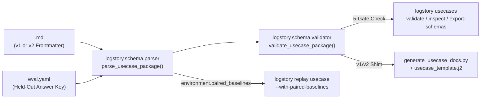

# Open Security Scenario & Logstory Usecase Metadata Standard (v2.0)

## 1. Purpose and Motivation

Security operations teams and AI agent researchers need a vendor-neutral standard to package synthetic or anonymized security scenarios ("log stories") so that:

1. **Telemetry Replay is Portable Across Platforms**: A single scenario package can be replayed into Google Security Operations (SecOps UDM), loaded into Databricks Lakehouse (Delta tables / OCSF), or queried in Splunk / Sigma pipelines.
2. **Blue Team Agent Evaluations are Blind and Reproducible**: Evaluating autonomous SOC agents across Alert Triage, Unalerted Threat Hunting ("Hunt Cymbal" mode), and Detection Engineering requires a strict anti-spoiler boundary between the **Scenario Stimulus** (`<USECASE>.md` + `EVENTS/` + `ENTITIES/`) and the **Held-Out Answer Key** (`eval.yaml` + `RULES/`).
3. **Signal Detection Theory (SDT) and Operational Safety are First-Class**: Benchmarks must test whether agents distinguish real attacks from confusable benign baselines (`CYMBAL_BASELINE_*` counterfactual twins), widen search horizons from 72h to 168h when required, respect maintenance windows, avoid blocking signed OS LOLBins, and avoid leaking RFC-1918/RFC-5737 internal IPs to external CTI tools.

---

## 2. Package Layout and Anti-Spoiler Boundary

Each usecase resides in a directory `<USECASE>/` with two distinct metadata files separating stimulus from evaluation ground truth:

```text
<USECASE>/
  <USECASE>.md              # 1. Telemetry & Replay Package Manifest (safe for blind agent setup)
  eval.yaml                 # 2. Held-out Blue Team Benchmark & Answer Key (NEVER mounted in agent sandbox)
  EVENTS/<LOG_TYPE>.log     # 3. Native-format event telemetry files
  ENTITIES/<LOG_TYPE>.log   # 4. Entity context roster files (optional)
  PARSER_EXTENSIONS/*.proto # 5. Platform parser extensions (optional)
  RULES/                    # 6. Reference detection rules (.yl2, .sigma.yml, .sql)
  _generate_events.py       # 7. Deterministic synthetic timeline generator (optional)
```

### 2.1 Boundary Invariants

1. **Zero Spoilers in `<USECASE>.md` Frontmatter**: The YAML frontmatter of `<USECASE>.md` declares only OKF v0.2 provenance, time windows, paired benign baselines, OCSF telemetry streams, and platform ingestion bindings. It must never contain attacker IOCs, compromised account names, CISA advisory IDs, MITRE ATT&CK kill-chain sequences, or expected verdicts.
2. **Markdown Body Delimiter (`<!-- BEGIN_SOLUTION -->`)**: Any human-facing attack narrative, indicator table, or rule walkthrough in `<USECASE>.md` must appear below an explicit `<!-- BEGIN_SOLUTION -->` HTML comment delimiter.
3. **Blind Inspection Mode**: Running `logstory usecases inspect <USECASE> --blind` returns only the `<USECASE>.md` frontmatter and Markdown content above `<!-- BEGIN_SOLUTION -->`, omitting `eval.yaml` and `RULES/`.
4. **Hermetic Sandbox Mounting**: Evaluation runners mount only `EVENTS/`, `ENTITIES/`, and blind metadata inside the agent runtime container; `eval.yaml` and `RULES/` remain exclusively in the host verifier/judge process.

---

## 3. `<USECASE>.md` Manifest Specification (`usecase.schema.json`)

`<USECASE>.md` begins with YAML frontmatter conforming to both Open Knowledge Format (OKF v0.2) and the `SecurityUsecaseManifest` v2.0 schema.

### 3.1 Schema Structure

| Field | Type | Required | Description |
|---|---|---|---|
| `schema_version` | `"2.0"` | Yes | Version of the usecase metadata specification. |
| `type` | `"SecurityUsecase"` | Yes | OKF v0.2 concept type discriminator. |
| `id` | `string` (`^[A-Z0-9_]+$`) | Yes | Canonical uppercase identifier matching directory name. |
| `title` | `string` | Yes | Human-readable scenario or telemetry package title. |
| `kind` | `"attack" \| "baseline" \| "hybrid"` | Yes | Whether the package contains attack events, benign baseline noise, or both. |
| `category` | `string` | Yes | High-level domain (`identity_cloud`, `endpoint_ransomware`, `network_c2`, `insider_risk`, `baseline`, `workshop`). |
| `description` | `string` | Yes | Blind-safe summary of the telemetry streams and operational window (no spoilers). |
| `tags` | `list[str]` | Yes | Non-spoiler discovery tags (e.g., `endpoint`, `windows`, `ocsf`, `google-secops`, `databricks`). |
| `created` | `date` (`YYYY-MM-DD`) | Yes | Initial authoring date. |
| `updated` | `date` (`YYYY-MM-DD`) | Yes | Last modification date. |
| `status` | `"draft" \| "stable" \| "deprecated"` | Yes | OKF v0.2 lifecycle status. |
| `sources` | `list[{id, resource}]` | No | OKF v0.2 source references (non-spoiler specs or generator pointers). |
| `generated` | `{by: str, at: datetime}` | No | OKF v0.2 generation provenance. |
| `verified` | `list[{by: str, at: datetime}]` | No | OKF v0.2 verification provenance. |
| `environment` | `EnvironmentSpec` | Yes | Organization canon, base date, UTC window, and `paired_baselines`. |
| `telemetry` | `TelemetrySpec` | Yes | Vendor-neutral `events` and `entities` stream definitions with OCSF mappings. |
| `platforms` | `PlatformBindings` | Yes | Platform-specific bindings (`google_secops`, `databricks`, `sigma`, `splunk`). |

### 3.2 `environment` Block

```yaml
environment:
  organization: cymbal-investments.org
  base_date: "2025-08-04"
  time_window_utc:
    start: "2025-08-04T13:00:00Z"
    end: "2025-08-04T17:00:00Z"
  paired_baselines:
    - CYMBAL_BASELINE_ENDPOINT
```

* `paired_baselines`: Lists one or more `CYMBAL_BASELINE_*` usecase IDs that share the same entity roster and log types and should be co-replayed into the same time window for realistic background noise and false-positive testing.

### 3.3 `telemetry` Block (OCSF v1.3+ Aligned)

Each file in `EVENTS/` and `ENTITIES/` is declared once in `telemetry.events` or `telemetry.entities` with a stable `stream_id`:

```yaml
telemetry:
  events:
    - stream_id: windows_security
      path: EVENTS/WINEVTLOG.log
      vendor_name: Microsoft
      product_name: Microsoft-Windows-Security-Auditing
      ocsf_category_uid: 3
      ocsf_class_uid: 3002
      ocsf_class_name: Authentication
      notes: "Windows Security Event Log stream"
  entities:
    - stream_id: windows_ad
      path: ENTITIES/WINDOWS_AD.log
      vendor_name: Microsoft
      product_name: Microsoft AD
      ocsf_category_uid: 5
      ocsf_class_uid: 5003
      ocsf_class_name: User Inventory
```

### 3.4 `platforms` Block

Platform-specific ingestion, table names, RBAC notes, and rule files live under `platforms.<platform_id>`:

* **`platforms.google_secops`**:
  * `run_frequency`: `{ events: str, entities: Optional[str] }`
  * `data_rbac`: `str`
  * `events`: `list[{ stream_id: str, log_type: str, notes: Optional[str] }]`
  * `entities`: `list[{ stream_id: str, log_type: str, notes: Optional[str] }]`
  * `rules`: `list[{ name: str, path: str, live: bool, alerting: bool, notes: Optional[str] }]`
  * `saved_searches`: `list[{ name: str, creator: Optional[str], notes: Optional[str] }]`
  * `reference_lists`: `list[{ name: str, type: Optional[str], notes: Optional[str] }]`
* **`platforms.databricks`**:
  * `catalog`: `str` (default `"security_lakehouse"`)
  * `schema_name`: `str` (default `"ocsf_silver"`)
  * `tables`: `list[{ stream_id: str, bronze_table: str, ocsf_table: str, format: str }]`
  * `queries`: `list[{ name: str, path: str, notes: Optional[str] }]`
* **`platforms.sigma`**:
  * `rules`: `list[{ name: str, path: str, level: Optional[str] }]`
* **`platforms.splunk`**:
  * `sourcetypes`: `list[{ stream_id: str, sourcetype: str, index: Optional[str] }]`

---

## 4. `eval.yaml` Benchmark Specification (`eval.schema.json`)

`eval.yaml` resides alongside `<USECASE>.md` and holds the platform-agnostic ground truth, compliance gates, counterfactual pairing, and task definitions for Blue Team agent evaluations.

### 4.1 Schema Structure

| Field | Type | Required | Description |
|---|---|---|---|
| `schema_version` | `"2.0"` | Yes | Evaluation schema version. |
| `type` | `"SecurityUsecaseEval"` | Yes | OKF v0.2 / schema type discriminator. |
| `usecase_id` | `string` | Yes | Must match `id` in `<USECASE>.md`. |
| `difficulty_tier` | `int` (`1..5`) | Yes | Progression difficulty (`1` Fundamentals .. `5` LOTL/Deception/Multi-Domain). |
| `release_day` | `Optional[int]` (`1..43`) | No | Canonical day index in the 43-day Hunt Cymbal curriculum. |
| `grounding` | `GroundingSpec` | Yes | `tier` (`stix_grounded`, `tradecraft_modeled`, `behavioral_synthetic`, `benign_baseline`) and `threat_actor` profile (`name`, `aliases`, `cisa_advisories`, `cves`, `mitre_group_id`). |
| `verdict` | `VerdictSpec` | Yes | `expected_disposition` (`TRUE_POSITIVE`, `BENIGN_POSITIVE`, `FALSE_POSITIVE`, `SUSPICIOUS_TRUE_POSITIVE`, `INCONCLUSIVE`), `expected_verdict` (`MALICIOUS`, `BENIGN`, `SUSPICIOUS`, `INCONCLUSIVE`), and `severity` (`LOW`, `MEDIUM`, `HIGH`, `CRITICAL`). |
| `kill_chain` | `list[KillChainStage]` | Yes | Chronological attack stages (`stage`, `timestamp_utc`, `tactic`, `technique_id`, `stream_id`, `summary`). Empty list `[]` for pure benign baselines. |
| `entities_and_iocs` | `EntitiesAndIocsSpec` | Yes | Ground-truth `compromised_accounts`, `affected_assets` (with `criticality_tier`, `patient_zero`, `blast_radius_fp_usd`, `blast_radius_fn_usd`), `malicious_iocs`, and `benign_confusers` (`signed_lolbins`, `internal_ips`, `change_window`). |
| `compliance_gates` | `ComplianceGatesSpec` | Yes | `requires_pre_containment_verification`, `requires_168h_horizon_widening`, `forbid_external_cti_on_internal_ips`, `forbid_lolbin_hash_blocking`, and `expected_actions` (`primary`, `secondary`, `prohibited`). |
| `counterfactual_pair` | `Optional[CounterfactualPairSpec]` | No | Links an attack scenario to its confusable benign twin (`pair_id`, `twin_usecase_id`, `shared_entities`, `discriminating_invariant`). |
| `tasks` | `EvalTasksSpec` | Yes | Multi-task benchmark definitions (`alert_triage`, `threat_hunt`, `detection_engineering`). |

### 4.2 Multi-Task Evaluation Contracts (`tasks`)

1. **`tasks.alert_triage`**:
   * `case_id`: Canonical SOAR/SIEM case identifier (e.g., `"CASE-AKIRA-01"`).
   * `initial_alerts`: Array of seed alerts (`alert_id`, `rule_name`, `severity`, `risk_score`).
   * `prompt`: Blind triage instruction presented to the agent under test.
   * `routing`: `{ expected_capability: str, skill_bindings: dict[str, str] }` mapping abstract defensive capability to harness-specific skill slugs (`google_secops`, `goose`, `databricks`).
   * `assertions`: `{ must_cite_entities: list[str], must_cite_mitre: list[str], must_not_contain: list[str] }`.
2. **`tasks.threat_hunt`**:
   * `prompt_unalerted`: Blind threat-hunt prompt ("Hunt Cymbal" mode) naming only the available telemetry streams and UTC time window.
   * `prompt_intel_driven`: Optional advisory/collection-driven hunt prompt.
   * `expected_patient_zero`: Hostname or account of initial compromise (`Optional[str]`, `null` for benign baselines).
3. **`tasks.detection_engineering`**:
   * `prompt`: Rule authoring prompt.
   * `target_techniques`: List of MITRE ATT&CK technique IDs to cover.
   * `expected_rule_count_min`: Minimum number of detection rules.
   * `max_false_positives_on_paired_baseline`: Maximum allowed false-positive detections when evaluated against `environment.paired_baselines` (default `0`).

---

## 5. Components, Data Flow, and Error Handling



### 5.1 Module Responsibilities

1. **`src/logstory/schema/models.py`**:
   * Defines strict Pydantic v2 models (`SecurityUsecaseManifest`, `SecurityUsecaseEval`, and nested types) with `extra="allow"` on `platforms` so third-party vendors can add experimental platform blocks while keeping core fields strictly typed.
   * Provides `export_json_schemas(output_dir: Path)` to write `schemas/usecase.schema.json` and `schemas/eval.schema.json` (JSON Schema Draft 2020-12).
2. **`src/logstory/schema/validator.py`**:
   * Executes 5 validation gates returning a structured `UsecaseValidationResult(usecase_id, is_valid, schema_version, errors, warnings)`:
     * **Gate 1 (Schema & OKF v0.2)**: Validates Pydantic models and OKF v0.2 top-level provenance keys.
     * **Gate 2 (Stream & Path Integrity)**: Verifies all `stream_id` references across `platforms.*` and `eval.yaml` `kill_chain` exist in `telemetry.{events,entities}`, and all referenced files (`EVENTS/*.log`, `ENTITIES/*.log`, `RULES/*`) exist on disk.
     * **Gate 3 (Anti-Spoiler Leakage)**: Verifies that none of `eval.yaml`'s `malicious_iocs` values, `compromised_accounts` user IDs, or `threat_actor.cisa_advisories` appear in `<USECASE>.md` frontmatter or above `<!-- BEGIN_SOLUTION -->` (for attack usecases).
     * **Gate 4 (Counterfactual Twin Consistency)**: Verifies that `counterfactual_pair.twin_usecase_id` in `eval.yaml` is declared in `<USECASE>.md`'s `environment.paired_baselines`.
     * **Gate 5 (v1 Legacy Compatibility)**: Accepts legacy v1 frontmatter when `strict_v2=False` (emitting a migration warning) and fails closed when `strict_v2=True`.
3. **`usecases/generate_usecase_docs.py` & `usecases/usecase_template.j2`**:
   * Updated with `normalize_frontmatter_for_template(frontmatter: dict) -> dict` so v2 manifests populate the legacy `events`, `entities`, `rules`, `run_frequency`, and `data_rbac` template keys from `telemetry` + `platforms.google_secops`, while also rendering OCSF and multi-platform sections.
4. **CLI Subcommands in `src/logstory/logstory.py`**:
   * `logstory usecases validate [USECASE_OR_PATH] [--strict-v2] [--json]`
   * `logstory usecases inspect <USECASE> [--blind] [--format json|yaml|md]`
   * `logstory usecases export-schemas [--output-dir schemas/]`
   * `logstory replay usecase <USECASE> [--with-paired-baselines]`: When `--with-paired-baselines` is enabled, resolves `environment.paired_baselines` from `<USECASE>.md` and replays each baseline usecase into the same `--timestamp-delta` window before replaying `<USECASE>`.
5. **Corpus Migration Script (`scripts/migrate_usecases_v2.py`)**:
   * Idempotent CLI tool that migrates all 47 usecases in `logstory_usecases` (43 attack scenarios + 4 `CYMBAL_BASELINE_*` scenarios) to v2 `<USECASE>.md` + `eval.yaml`, inserting `<!-- BEGIN_SOLUTION -->` before the spoiler narrative in `<USECASE>.md`.

---

## 6. Testing and Verification Strategy

1. **Unit & Schema Tests (`tests/test_usecase_schema.py`)**:
   * Validates v2 `SecurityUsecaseManifest` and `SecurityUsecaseEval` models on valid fixtures.
   * Verifies Gate 2 catches dangling `stream_id` and missing `EVENTS/*.log` files.
   * Verifies Gate 3 catches an IOC, compromised account, or CISA advisory leaked into `<USECASE>.md` frontmatter or above `<!-- BEGIN_SOLUTION -->`.
   * Verifies Gate 4 catches a mismatch between `counterfactual_pair.twin_usecase_id` and `environment.paired_baselines`.
   * Verifies v1 backwards compatibility in both `validate_usecase_package(..., strict_v2=False)` and `generate_usecase_docs.py`.
   * Verifies `export_json_schemas()` produces deterministic, valid Draft 2020-12 JSON Schemas.
2. **CLI Integration Tests (`tests/test_usecase_cli_metadata.py`)**:
   * Tests `logstory usecases validate`, `logstory usecases inspect --blind` (confirming zero spoilers in output), `logstory usecases export-schemas`, and `logstory replay usecase --with-paired-baselines --local-file-output`.
3. **Full Corpus Conformance Gate**:
   * Runs `logstory usecases validate --strict-v2` across all migrated usecases in `logstory` (`RULES_SEARCH_WORKSHOP`, `NETWORK_ANALYSIS`) and all 47 scenarios in `logstory_usecases` with 0 errors.
